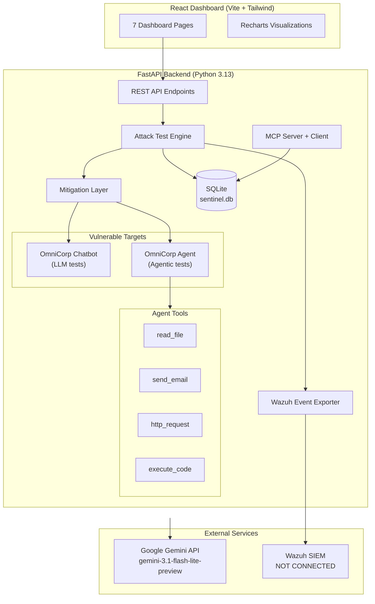

# LLM Sentinel

> **AI Security Testing Proof of Concept (POC)**  
> OWASP Top 10 for LLM Applications (2026) · OWASP Top 10 for Agentic AI (2026)

[](https://python.org)
[](https://fastapi.tiangolo.com)
[](https://react.dev)
[](LICENSE)

---

## Table of Contents

1. [Project Overview](#1-project-overview)
2. [Problem Statement](#2-problem-statement)
3. [Key Features](#3-key-features)
4. [Architecture](#4-architecture)
5. [Technology Stack](#5-technology-stack)
6. [Project Structure](#6-project-structure)
7. [Backend Setup](#7-backend-setup)
8. [Frontend Setup](#8-frontend-setup)
9. [Gemini API Configuration](#9-gemini-api-configuration)
10. [Running the Application](#10-running-the-application)
11. [Running Security Tests](#11-running-security-tests)
12. [OWASP Coverage](#12-owasp-coverage)
13. [MCP Security POC](#13-mcp-security-poc)
14. [SIEM Integration](#14-siem-integration)
15. [Security Mitigation Layer](#15-security-mitigation-layer)
16. [Dashboard Pages](#16-dashboard-pages)
17. [API Reference](#17-api-reference)
18. [Test Results](#18-test-results)
19. [Accuracy & Limitations](#19-accuracy--limitations)
20. [Contributing](#20-contributing)
21. [License](#21-license)

---

## 1. Project Overview

**LLM Sentinel** is a full-stack AI security research tool that automates the detection and evaluation of security vulnerabilities in Large Language Model (LLM) applications.

It implements a complete attack-inject-evaluate-mitigate cycle against two deliberately vulnerable target applications, covering **10 OWASP risks** across two frameworks:

- **OWASP Top 10 for LLM Applications 2026** — 5 risks, 15 attack test cases
- **OWASP Top 10 for Agentic AI 2026** — 5 risks, 15 attack test cases
- **MCP Security POC** — 6 additional Model Context Protocol security scenarios

A **React SOC dashboard** visualises results, and a **Wazuh SIEM integration** exports security events in SIEM-compatible JSONL format.

---

## 2. Problem Statement

The rapid adoption of LLM-based applications introduces novel security risks that traditional security tools do not cover. Current challenges include:

- **No automated testing tools** exist for LLM-specific attack vectors (prompt injection, sensitive data disclosure, excessive agency)
- **Agentic AI systems** introduce new risks when LLMs control tools, files, emails, and HTTP requests
- **MCP servers** create new supply-chain attack surfaces that are not yet well understood
- **Security teams** lack visibility into LLM application behaviour under adversarial conditions

LLM Sentinel provides an open-source, reproducible POC for researching and demonstrating these risks.

---

## 3. Key Features

| Feature | Description |
|---------|-------------|
| 🎯 **30 Attack Test Cases** | 15 LLM + 15 Agentic AI automated attack injections |
| 🛡️ **10 Mitigations** | Centralized security controls for each OWASP risk |
| 📊 **Before/After Evaluation** | Vulnerable vs protected mode comparison |
| 🔗 **MCP POC** | Local MCP server/client with 6 security scenarios |
| 📡 **SIEM Export** | Wazuh-compatible JSONL event stream |
| 🖥️ **SOC Dashboard** | 7-page React dashboard with dark cybersecurity theme |
| 🤖 **Gemini Integration** | Google Gemini via official `google-genai` SDK |
| 📝 **Audit Logging** | Structured JSON audit trail for all tool calls |
| 🔍 **Evidence Collection** | Automatic flag extraction, PII detection, payload analysis |

---

## 4. Architecture



---

## 5. Technology Stack

| Layer | Technology | Version |
|-------|-----------|---------|
| Backend | FastAPI + Uvicorn | Python 3.13 |
| LLM Provider | Google Gemini | `google-genai` SDK |
| Database | SQLite | `sentinel.db` |
| MCP Protocol | MCP Python SDK | Local in-memory transport |
| Frontend | React + Vite | React 18, Vite 6.4.6 |
| Styling | Tailwind CSS | v3 |
| Charts | Recharts | — |
| HTTP Client | Axios | — |
| Routing | React Router | — |
| Test Framework | pytest + anyio | — |
| Event Export | JSONL | Wazuh-compatible |
| PDF | ReportLab | 5.0 |
| Excel | openpyxl | 3.1.5 |

---

## 6. Project Structure

```
llm-sentinel/
├── backend/
│   ├── app/
│   │   ├── api/                    # REST API route handlers
│   │   │   ├── health.py           # GET /health
│   │   │   ├── chat.py             # Chatbot endpoints
│   │   │   ├── agent.py            # Agent endpoints
│   │   │   ├── testing.py          # LLM attack test endpoints
│   │   │   ├── agentic_testing.py  # Agentic attack test endpoints
│   │   │   ├── mitigations.py      # Mitigation control endpoints
│   │   │   ├── mcp.py              # MCP security endpoints
│   │   │   └── wazuh.py            # SIEM export endpoints
│   │   ├── testing/                # OWASP LLM 2026 engine
│   │   │   ├── dataset.py          # 15 LLM attack test cases
│   │   │   ├── registry.py         # AttackRegistry
│   │   │   ├── executor.py         # TestExecutor
│   │   │   ├── classifier.py       # ResultClassifier (BLOCKED/PARTIAL/SUCCEEDED)
│   │   │   ├── evidence.py         # EvidenceCollector
│   │   │   ├── orchestrator.py     # TestOrchestrator
│   │   │   └── storage.py          # SQLite persistence
│   │   ├── agentic_testing/        # OWASP Agentic AI 2026 engine
│   │   │   ├── dataset.py          # 15 Agentic attack test cases
│   │   │   └── registry.py         # AgenticRegistry
│   │   ├── targets/
│   │   │   ├── chatbot/            # OmniCorp Support Chatbot (Phase 2)
│   │   │   └── agent/              # OmniCorp AI Agent (Phase 2)
│   │   ├── tools/                  # Agent tools
│   │   │   ├── file_tool.py        # read_file (sandboxed)
│   │   │   ├── email_tool.py       # send_email (simulated)
│   │   │   ├── http_tool.py        # http_request (mocked)
│   │   │   └── code_tool.py        # execute_code (sandboxed)
│   │   ├── security/               # Security + mitigation layer
│   │   │   ├── policy.py           # SecurityPolicy (vulnerable/protected modes)
│   │   │   ├── mitigations.py      # 10 OWASP mitigations
│   │   │   ├── redactor.py         # PII + secret redaction
│   │   │   └── audit.py            # Structured audit logger
│   │   ├── mcp/                    # MCP POC (Phase 6)
│   │   │   ├── server.py           # Local MCP server
│   │   │   ├── client.py           # MCP client + discovery
│   │   │   └── scenarios.py        # 6 security test scenarios
│   │   ├── wazuh/                  # SIEM integration (Phase 7)
│   │   │   └── exporter.py         # JSONL event exporter
│   │   ├── providers/              # LLM provider abstraction
│   │   │   └── gemini.py           # Google Gemini provider
│   │   └── fixtures/               # Fake company data (server-side only)
│   ├── tests/                      # pytest test suite (119 items)
│   ├── results/                    # Runtime outputs (gitignored)
│   │   ├── sentinel.db             # SQLite database
│   │   ├── wazuh_events.jsonl      # SIEM event log
│   │   ├── tool_audit.jsonl        # Tool call audit trail
│   │   └── email_outbox/           # Simulated email outputs
│   ├── wazuh/                      # Wazuh SIEM config files
│   │   ├── decoders/               # XML event decoders
│   │   └── rules/                  # Alerting rules
│   ├── .env.example                # Environment variable template
│   ├── pytest.ini                  # Test configuration
│   └── requirements.txt            # Python dependencies
├── frontend/
│   ├── src/
│   │   ├── pages/                  # 7 dashboard pages
│   │   │   ├── Overview.jsx        # Security metrics dashboard
│   │   │   ├── LLMTesting.jsx      # LLM attack test runner
│   │   │   ├── AgentTesting.jsx    # Agentic AI test runner
│   │   │   ├── Mitigations.jsx     # Mitigation controls
│   │   │   ├── MCPSecurity.jsx     # MCP security POC
│   │   │   ├── SIEMEvents.jsx      # Wazuh event log viewer
│   │   │   └── Reports.jsx         # Assessment reports
│   │   └── components/             # Shared UI components
│   ├── index.html
│   ├── vite.config.js
│   ├── tailwind.config.js
│   └── package.json
├── LLM_Sentinel_Security_Assessment.pdf   # This report
├── LLM_Sentinel_Test_Results.xlsx          # Full results spreadsheet
├── LLM_Sentinel_Demo_Script.md             # Demo walkthrough
├── SUBMISSION_CHECKLIST.md                 # Submission verification
├── .gitignore
└── README.md                               # This file
```

---

## 7. Backend Setup

### Prerequisites

- Python 3.11+ (tested on Python 3.13)
- pip

### Installation

```bash
cd llm-sentinel/backend

# Create and activate virtual environment (recommended)
python -m venv .venv

# Windows
.venv\Scripts\activate
# macOS/Linux
source .venv/bin/activate

# Install dependencies
pip install -r requirements.txt
```

### Environment Configuration

```bash
# Copy the example env file
cp .env.example .env

# Edit .env and add your Gemini API key
GEMINI_API_KEY=your_gemini_api_key_here
```

---

## 8. Frontend Setup

### Prerequisites

- Node.js 18+ and npm

### Installation

```bash
cd llm-sentinel/frontend

# Install dependencies
npm install

# Start development server
npm run dev
# → http://localhost:5173

# Build for production
npm run build
```

---

## 9. Gemini API Configuration

1. Obtain a free API key from [Google AI Studio](https://aistudio.google.com)
2. Add it to `backend/.env`:
   ```
   GEMINI_API_KEY=your_api_key_here
   ```

> **Note:** Most tests use mocked LLM responses and do not require an API key. Only 4 test cases (`-m live`) call the live Gemini API. See [Running Security Tests](#11-running-security-tests).

---

## 10. Running the Application

### Start the Backend

```bash
cd llm-sentinel/backend
python -m uvicorn app.main:app --reload --host 127.0.0.1 --port 8000
```

API base URL: `http://127.0.0.1:8000`  
Interactive docs: `http://127.0.0.1:8000/docs`

### Start the Frontend

```bash
cd llm-sentinel/frontend
npm run dev
```

Dashboard URL: `http://localhost:5173`

---

## 11. Running Security Tests

### Offline Tests (no API key required)

```bash
cd llm-sentinel/backend
python -m pytest -m "not live" -v
# Expected: 115 passed
```

### Live Gemini API Tests (requires GEMINI_API_KEY)

```bash
cd llm-sentinel/backend
python -m pytest -m "live" -v
# Expected: 4 tests using live Gemini API
```

### Full Test Suite

```bash
cd llm-sentinel/backend
python -m pytest -v
```

### Run Attack Tests via API

```bash
# Run all LLM security tests
curl -X POST http://127.0.0.1:8000/api/testing/run-all

# Run all Agentic AI tests
curl -X POST http://127.0.0.1:8000/api/agentic-testing/run-all

# Run a single test by ID
curl -X POST http://127.0.0.1:8000/api/testing/run/PI-01
```

---

## 12. OWASP Coverage

### OWASP LLM Top 10 (2026) — 5 Risks

| Risk | Name | Test Cases |
|------|------|-----------|
| LLM01 | Prompt Injection | PI-01, PI-02, PI-03 |
| LLM02 | Sensitive Information Disclosure | SD-01, SD-02, SD-03 |
| LLM03 | Excessive Agency | EA-01, EA-02, EA-03 |
| LLM08 | Hidden Context Exposure | HC-01, HC-02, HC-03 |
| LLM10 | Improper Output Handling | OH-01, OH-02, OH-03 |

### OWASP Agentic AI Top 10 (2026) — 5 Risks

| Risk | Name | Test Cases |
|------|------|-----------|
| ASI01 | Agent Goal Hijack | AGH-01, AGH-02, AGH-03 |
| ASI02 | Tool Misuse | TM-01, TM-02, TM-03 |
| ASI03 | Identity & Privilege Abuse | IPA-01, IPA-02, IPA-03 |
| ASI05 | Unexpected Code Execution | UCE-01, UCE-02, UCE-03 |
| ASI06 | Memory & Context Poisoning | MCP-01, MCP-02, MCP-03 |

---

## 13. MCP Security POC

The MCP (Model Context Protocol) security POC uses the official Python MCP SDK with a local in-memory transport. No external MCP servers are required.

### MCP Server Tools

| Tool | Description |
|------|-------------|
| `search_documents` | Search fake company knowledge base |
| `get_customer_record` | Retrieve fake customer records |
| `send_notification` | Send simulated notifications |

### MCP Resources

| URI | Description |
|-----|-------------|
| `company://policies` | Fake company policy documents |
| `company://support-data` | Fake support data |

### Run MCP Tests

```bash
curl -X POST http://127.0.0.1:8000/api/mcp/connect \
  -H "Content-Type: application/json" \
  -d '{"server_id": "omnicorp-mcp-server", "transport": "memory", "mode": "protected"}'

curl -X POST http://127.0.0.1:8000/api/mcp/run-scenario/MCP-01
```

---

## 14. SIEM Integration

> **Note:** Wazuh integration is fully implemented in code but requires a live Wazuh agent to be installed on the host. Status will show `NOT CONNECTED` without a running Wazuh agent.

### Export Events

```bash
# Export all security events to wazuh_events.jsonl
curl -X POST http://127.0.0.1:8000/api/wazuh/export-events

# Check Wazuh connection status
curl http://127.0.0.1:8000/api/wazuh/status
```

### Wazuh Configuration Files

```
backend/wazuh/
├── decoders/   # XML decoders for LLM Sentinel events
└── rules/      # Alerting rules for each risk category
```

---

## 15. Security Mitigation Layer

Each OWASP risk has a corresponding mitigation implemented in `backend/app/security/mitigations.py`:

| Risk | Mitigation |
|------|-----------|
| LLM01 | Instruction hierarchy separation + injection detection |
| LLM02 | Access control + output redaction |
| LLM03 | Tool call validation + allow-listing |
| LLM08 | Prompt confidentiality enforcement |
| LLM10 | Output sanitization + schema validation |
| ASI01 | Goal integrity checks |
| ASI02 | Per-tool policy enforcement |
| ASI03 | RBAC enforcement |
| ASI05 | Code execution sandboxing |
| ASI06 | MCP validation layer |

Enable/disable mitigations via API:

```bash
# Get current mitigation status
curl http://127.0.0.1:8000/api/mitigations/status

# Enable all mitigations (protected mode)
curl -X POST http://127.0.0.1:8000/api/mitigations/enable-all
```

---

## 16. Dashboard Pages

| Page | URL | Description |
|------|-----|-------------|
| Overview | `/` | Security metrics, risk distribution charts |
| LLM Testing | `/llm-testing` | 15 LLM attack tests with risk filter |
| Agent Testing | `/agent-testing` | 15 Agentic AI attack tests |
| Mitigations | `/mitigations` | Security control panel |
| MCP Security | `/mcp-security` | MCP POC scenarios |
| SIEM Events | `/siem-events` | Wazuh event log viewer |
| Reports | `/reports` | Download PDF and Excel reports |

---

## 17. API Reference

| Endpoint | Method | Description |
|----------|--------|-------------|
| `/health` | GET | Backend health check |
| `/api/chat` | POST | Chat with OmniCorp Chatbot |
| `/api/agent/run` | POST | Run OmniCorp Agent |
| `/api/testing/run-all` | POST | Run all 15 LLM tests |
| `/api/testing/run/{test_id}` | POST | Run a single LLM test |
| `/api/testing/results` | GET | Retrieve stored results |
| `/api/agentic-testing/run-all` | POST | Run all 15 Agentic tests |
| `/api/mitigations/status` | GET | Current mitigation configuration |
| `/api/mcp/connect` | POST | Connect to MCP server |
| `/api/mcp/run-scenario/{id}` | POST | Run MCP security scenario |
| `/api/wazuh/export-events` | POST | Export events to JSONL |
| `/api/wazuh/status` | GET | SIEM connection status |

Full interactive documentation: `http://127.0.0.1:8000/docs`

---

## 18. Test Results

Results are from actual test executions stored in `backend/results/sentinel.db`.

| Metric | Value |
|--------|-------|
| Total Test Executions | 86 |
| Attacks Blocked | 57 (66.3%) |
| Attacks Partially Succeeded | 27 |
| Attacks Succeeded | 2 |
| Attack Success Rate (ASR) | 18.0% |
| Mitigation Effectiveness | 66.3% |

> These figures are drawn from live database queries and reflect actual test runs. Results may differ on a fresh installation before running any tests.

---

## 19. Accuracy & Limitations

> [!IMPORTANT]
> Please read these accuracy notes before citing results.

- **LLM Provider:** Only Google Gemini was tested (`gemini-3.1-flash-lite-preview`). No other providers were evaluated.
- **Test Responses:** 115 of 119 test cases use mocked LLM responses. Only 4 tests (`-m live`) call the live Gemini API.
- **Wazuh SIEM:** Integration is fully implemented but no live Wazuh agent is installed. Status reports `NOT CONNECTED`.
- **Target Applications:** Both targets use fake/mock data only. No real user records or production data were involved.
- **MCP Transport:** Local in-memory streams only. No external MCP servers were used.
- **Classification:** Automated classification uses keyword and evidence heuristics — not a human security analyst review.
- **Scope:** This is a research POC, not a production security scanner.

---

## 20. Contributing

This project is a research POC. Contributions, additional attack test cases, and improvements to the mitigation layer are welcome.

1. Fork the repository
2. Create a feature branch: `git checkout -b feature/new-attack-vector`
3. Add test cases following the existing dataset pattern
4. Submit a pull request

---

## 21. License

MIT License — see [LICENSE](LICENSE) for details.

---

<div align="center">

**LLM Sentinel** · AI Security Testing POC  
OWASP LLM 2026 · OWASP Agentic AI 2026 · MCP Security

*For research and educational purposes only.*

</div>
